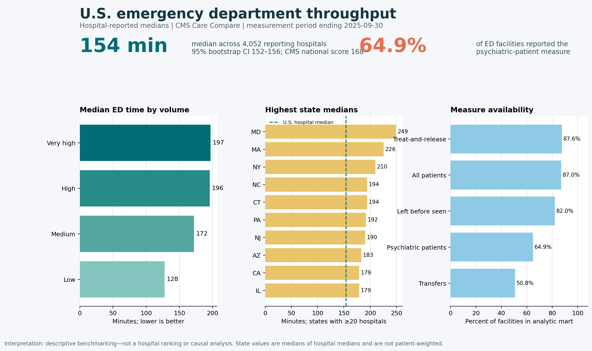

# CMS Emergency Department Throughput Benchmarking


## Executive summary

Emergency-department time is both a patient-experience signal and an operational planning measure. This project uses the July 2026 CMS Care Compare release to benchmark hospital-reported ED times, test whether throughput differs across ED volume categories, and quantify where public reporting is incomplete.



Among **4,052 hospitals reporting OP-18a**, the median hospital reported **154 minutes** from ED arrival to departure (95% bootstrap CI: **152–156 minutes**). The official CMS national score was **168 minutes**; it is not interchangeable with the unweighted median across hospitals calculated here. Median time increased from **128 minutes** at low-volume EDs to **197 minutes** at very-high-volume EDs. Only **64.9%** of facilities in the ED analytic mart reported a usable psychiatric-patient ED time.

These results are descriptive signals for benchmarking and data-quality review. They are not a hospital ranking, a causal analysis, or evidence about an individual patient's expected wait.

## Decision question

Where do publicly reported ED throughput measures indicate operational benchmarking priorities, and how does measure availability limit interpretation?

**Audience:** hospital quality teams, healthcare analysts, public-health planners, and recruiters assessing healthcare-data skills.

**Use case:** identify peer groups and states that warrant deeper operational review, then pair these public measures with internal arrival-pattern, staffing, acuity, boarding, and capacity data.

## Key findings

- **Coverage:** 4,052 of 4,658 facilities (87.0%) had a numeric OP-18a value.
- **Central tendency:** the median of hospital medians was 154 minutes (IQR: 125–194.25); the separately published CMS national score was 168 minutes.
- **Volume gradient:** hospital medians were 128, 172, 196, and 197 minutes across low, medium, high, and very-high ED volume categories. A Kruskal–Wallis test found distributional differences across groups (H=1,494.18; p<0.001). This association is not causal.
- **State benchmarking:** among states with at least 20 reporting hospitals, Maryland had the highest median (249 minutes), followed by Massachusetts (225.5) and New York (210).
- **Reporting gap:** 64.9% reported psychiatric-patient ED time and 50.8% reported transfer time, limiting complete comparisons.
- **Review list:** 640 hospitals met a transparent screening rule: OP-18a at or above the 75th percentile and at least 60 minutes above the hospital-level median. The list is for review, not labeling performance.

## Methods at a glance

```text
CMS Provider Data Catalog
        │
        ├─ Timely and Effective Care (6 ED measures)
        ├─ Hospital General Information
        └─ National ED measures
        │
        ▼
Python acquisition + SHA-256 manifest
        │
        ▼
DuckDB cleaning, validation, pivot and joins
        │
        ▼
Python statistics, benchmark tables and dashboard
        │
        ├─ reproducibility tests
        └─ Tableau/Power BI-ready CSV outputs
```

The primary analysis uses OP-18a: the hospital-reported median time all ED patients spent in the ED before leaving, including psychiatric/mental-health patients and transfers. Lower values are better. Group summaries are medians across hospitals; they are **not patient-weighted**.

For full definitions, inclusion rules, QA logic, and analytic choices, see [docs/methodology.md](docs/methodology.md).

## Repository structure

```text
.
├── data/
│   ├── raw/                 # Date-stamped CMS extracts + checksum manifest
│   └── processed/           # One-row-per-facility analytic mart
├── docs/
│   ├── data_dictionary.md
│   ├── methodology.md
│   └── references.md
├── outputs/
│   ├── figures/             # Recruiter-ready dashboard
│   └── tables/              # Benchmarks, QA, review list, key results
├── sql/                     # DuckDB transformation and QA queries
├── src/                     # Acquisition and analysis programs
├── tests/                   # Reproducibility assertions
├── LINKEDIN_POST_DRAFT.md
├── PORTFOLIO_CASE_STUDY.md
└── run_pipeline.ps1
```

## Reproduce the analysis

Requirements: Python 3.12+ and internet access for the CMS download step.

```powershell
git clone https://github.com/gorkira28/cms-ed-throughput-benchmarking.git
cd cms-ed-throughput-benchmarking
python -m venv .venv
.venv\Scripts\Activate.ps1
pip install -r requirements.txt
python src/acquire_data.py --as-of 2026-10-16
python src/analyze.py
python tests/test_outputs.py
```

Or run `./run_pipeline.ps1` from PowerShell. CMS refreshes these files, so a later run can produce different results. Change `--as-of` to the actual retrieval date when refreshing.

## Data quality and validation

- Source files are resolved from CMS dataset metadata rather than hard-coded download URLs.
- Raw files are date-stamped and recorded with row counts, dimensions, and SHA-256 checksums.
- CMS facility IDs are retained as six-character strings to preserve leading zeros.
- The SQL workflow verifies one facility-measure row, successful hospital joins, valid percentages, and non-negative times.
- Automated tests validate row grain, identifiers, ranges, output presence, and reporting volume.
- Missing/suppressed CMS values remain missing; no values are imputed.

See [outputs/tables/qa_checks.csv](outputs/tables/qa_checks.csv) for the executed checks.

## Responsible interpretation

Publicly reported hospital medians do not describe the full distribution of patient experience. They do not adjust for patient acuity, case mix, staffing, local referral patterns, boarding, or capacity constraints. A high value may identify a question worth investigating; it does not by itself establish poor care or its cause. State summaries can be influenced by hospital mix, reporting availability, and small counts. Psychiatric and transfer measures have substantial missingness.

Only public, facility-level CMS data are used. There is no PHI, patient-level data, Texas DSHS information, or proprietary employer material in this repository.

## Skills demonstrated

`Python` · `DuckDB SQL` · `CMS API and metadata` · `healthcare quality measurement` · `data validation` · `nonparametric statistics` · `bootstrap confidence intervals` · `data visualization` · `reproducible analytics` · `Tableau/Power BI-ready outputs`

## Source and license

Primary data come from the CMS Provider Data Catalog. Source URLs and methodology references are documented in [docs/references.md](docs/references.md). Code is licensed under the [MIT License](LICENSE); CMS public data retain their original terms.

## Author

**Kira Gor, BDS, MPH**  
Applied Epidemiologist & Health Data Analyst  
[LinkedIn](https://www.linkedin.com/in/dr-kira-gor/) · [Portfolio](https://gorkira28.github.io/) · [GitHub](https://github.com/gorkira28)

